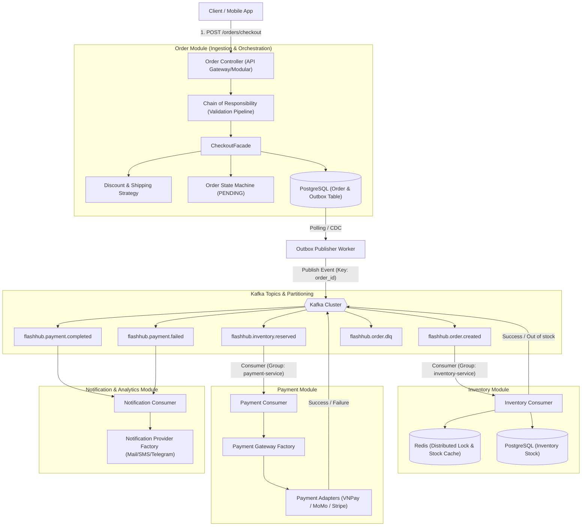
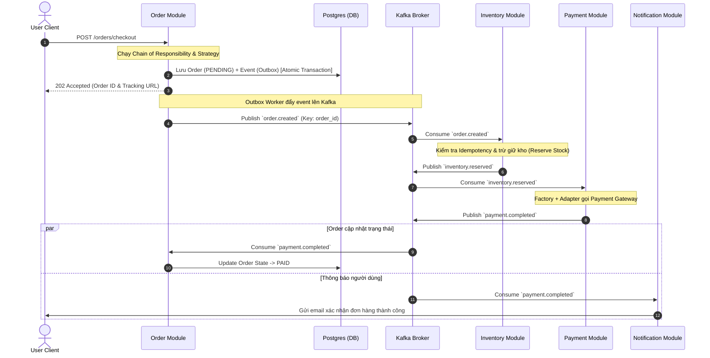
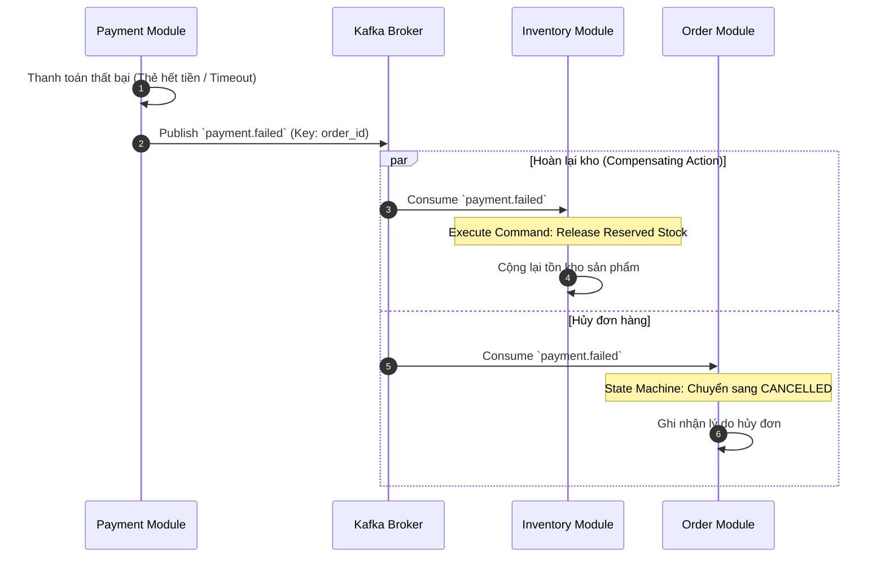
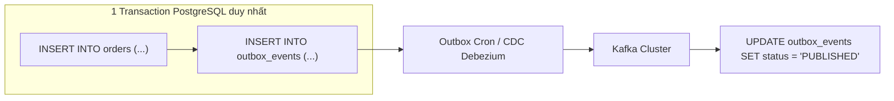
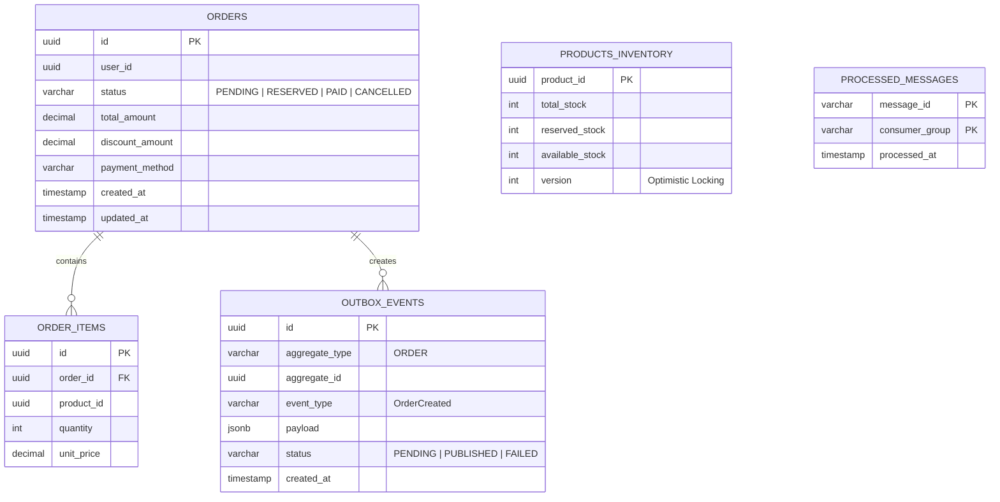

# 🏗️ Kiến Trúc Hệ Thống: FlashHub Engine
> **Event-Driven Flash Sale & Order Fulfillment Platform**  
> Dự án mẫu ứng dụng **NestJS**, **GoF Design Patterns** và **Apache Kafka** để giải quyết bài toán chịu tải cao, nhất quán dữ liệu phân tán (Eventual Consistency) và Clean Code.

---

## 1. Tổng Quan Hệ Thống (System Overview)

FlashHub mô phỏng luồng xử lý đơn hàng Flash Sale tốc độ cao:
- **High Concurrency & Low Latency**: Tiếp nhận hàng nghìn request/s trong đợt mở bán, phản hồi `202 Accepted` ngay lập tức và đưa vào hàng đợi xử lý bất đồng bộ.
- **Event-Driven & Decoupled**: Các thành phần (Order, Inventory, Payment, Notification) giao tiếp phi tập trung qua **Apache Kafka**.
- **Design Pattern Driven**: Vận dụng tự nhiên các mẫu thiết kế GoF để code mở rộng linh hoạt (OCP), dễ test và bảo trì.

---

## 2. Sơ Đồ Kiến Trúc Tổng Thể (System Architecture)



---

## 3. Luồng Nghiệp Vụ Chính (Core Workflows)

### 3.1. Luồng Thành Công (Happy Path - Choreography Saga)



---

### 3.2. Luồng Bù Trừ Phân Tán (Saga Compensating / Rollback Flow)
Kịch bản: Đã giữ kho thành công nhưng **thanh toán thất bại**. Hệ thống phải tự động hoàn lại số lượng tồn kho.



---

## 4. Chi Tiết Ứng Dụng GoF Design Patterns

### 4.1. Creational Patterns (Khởi Tạo)
* **Factory Method / Abstract Factory**:
  * *Vị trí*: `src/modules/payment/factories/payment-gateway.factory.ts`
  * *Mục đích*: Cung cấp cổng thanh toán tương ứng dựa theo enum (`VNPAY`, `MOMO`, `STRIPE`, `COD`). Dễ dàng thêm cổng mới mà không sửa logic cũ (Open/Closed Principle).
* **Builder Pattern**:
  * *Vị trí*: `src/modules/order/builders/order.builder.ts`
  * *Mục đích*: Xây dựng đối tượng Order phức tạp gồm: Customer Info, Line Items, Applied Discounts, Shipping Address, Billing Metadata, Snapshot giá lúc mua.

### 4.2. Structural Patterns (Cấu Trúc)
* **Adapter Pattern**:
  * *Vị trí*: `src/modules/payment/adapters/vnpay.adapter.ts`, `momo.adapter.ts`
  * *Mục đích*: Mỗi 3rd-party Payment SDK có format request/response khác nhau. Adapter chuyển đổi chúng về cùng chuẩn interface `IPaymentGateway` (`charge()`, `refund()`, `verifyWebhook()`).
* **Strategy Pattern**:
  * *Vị trí*: `src/modules/order/strategies/discount/` & `shipping/`
  * *Mục đích*:
    - **DiscountStrategy**: `PercentageDiscountStrategy`, `FixedAmountDiscountStrategy`, `VipTierDiscountStrategy`.
    - **ShippingStrategy**: `StandardShippingStrategy`, `ExpressShippingStrategy`.
* **Decorator Pattern**:
  * *Vị trí*: `src/common/decorators/idempotent.decorator.ts` & `kafka-retry.decorator.ts`
  * *Mục đích*:
    - `@Idempotent({ keyFrom: 'orderId', ttl: 3600 })`: Tự động check Redis trước khi chạy method, chặn duplicate message từ Kafka.
    - `@AuditLog()`: Tự động ghi lại metadata request/event.
* **Facade Pattern**:
  * *Vị trí*: `src/modules/order/facades/checkout.facade.ts`
  * *Mục đích*: Che giấu sự phức tạp của hệ thống con, cung cấp 1 hàm `executeCheckout(dto)` duy nhất cho Controller.

### 4.3. Behavioral Patterns (Hành Vi)
* **State Pattern**:
  * *Vị trí*: `src/modules/order/states/`
  * *Mục đích*: Quản lý vòng đời trạng thái của Order: `PendingState`, `ReservedState`, `PaidState`, `CancelledState`. Ngăn chặn chuyển đổi trạng thái phi logic (ví dụ: đã Cancelled thì không thể chuyển sang Shipped).
* **Chain of Responsibility**:
  * *Vị trí*: `src/modules/order/pipes/validation-chain/`
  * *Mục đích*: Tạo pipeline kiểm tra checkout:
    `UserBlacklistHandler` ➔ `FlashSaleLimitHandler` ➔ `StockAvailabilityHandler` ➔ `FraudRiskHandler`.
* **Command Pattern**:
  * *Vị trí*: `src/modules/inventory/commands/`
  * *Mục đích*: Đóng gói hành động `ReserveStockCommand` và hành động bồi hoàn `ReleaseStockCommand` (Undo).

---

## 5. Kiến Trúc Kafka & Distributed Patterns

### 5.1. Bảng Topic & Partitioning Strategy

| Topic Name | Key | Event Payload | Consumer Groups |
| :--- | :--- | :--- | :--- |
| `flashhub.order.created` | `order_id` | `OrderCreatedEvent` | `inventory-group`, `audit-group` |
| `flashhub.inventory.reserved` | `order_id` | `InventoryReservedEvent` | `payment-group`, `order-group` |
| `flashhub.inventory.failed` | `order_id` | `InventoryFailedEvent` | `order-group`, `notification-group` |
| `flashhub.payment.completed` | `order_id` | `PaymentCompletedEvent` | `order-group`, `notification-group` |
| `flashhub.payment.failed` | `order_id` | `PaymentFailedEvent` | `order-group`, `inventory-group` (compensate) |
| `flashhub.order.retry` | `order_id` | `RetryEnvelope<T>` | `order-retry-group` |
| `flashhub.order.dlq` | `order_id` | `DLQEnvelope<T>` | `ops-alert-group` |

> **Quy tắc Message Ordering**: Luôn dùng **`order_id`** làm Kafka Partition Key để tất cả các event của cùng 1 đơn hàng rơi vào cùng 1 Partition, bảo đảm đúng thứ tự xử lý tuyệt đối.

---

### 5.2. Transactional Outbox Pattern
Giải quyết bài toán **Dual-Write** (không thể đảm bảo vừa ghi Database vừa gửi Kafka thành công 100%):



---

### 5.3. Idempotent Consumer Pattern
Kafka đảm bảo *At-Least-Once Delivery*, nghĩa là Consumer có thể nhận 1 message nhiều lần (khi rebalance mạng hoặc crash).
* Bảng lưu trữ: `processed_messages (message_id PK, consumer_group, processed_at)` hoặc dùng Redis `SET key NX EX`.
* Trước khi xử lý event: Kiểm tra `message_id` đã tồn tại chưa. Nếu có rồi ➔ `ACK` ngay và bỏ qua xử lý nghiệp vụ.

---

### 5.4. Retry & Dead Letter Queue (DLQ)
Khi Consumer xử lý lỗi (ví dụ bên Payment timeout):
1. **Lần 1 - 3**: Retry với exponential backoff (đẩy sang topic `flashhub.*.retry`).
2. **Vượt quá số lần**: Đẩy sang `flashhub.*.dlq` để bảo vệ consumer không bị block partition, đồng thời gửi cảnh báo tới hệ thống giám sát.

---

## 6. Cấu Trúc Thư Mục Chuẩn (Clean Architecture trong NestJS)

```text
src/
├── common/                          # Dùng chung toàn hệ thống
│   ├── constants/
│   ├── decorators/                  # @Idempotent, @AuditLog
│   ├── filters/                     # AllExceptionsFilter
│   ├── interceptors/
│   └── kafka/                       # Kafka Client Base, Consumer Decorators
│       ├── kafka.producer.service.ts
│       └── kafka.consumer.abstract.ts
│
├── config/                          # Configuration (Kafka, Database, Redis)
│
├── modules/
│   ├── order/                       # ORDER MODULE
│   │   ├── controllers/             # OrderController (REST API)
│   │   ├── facades/                 # CheckoutFacade
│   │   ├── services/                # OrderService
│   │   ├── builders/                # OrderBuilder
│   │   ├── pipes/validation-chain/  # Chain of Responsibility handlers
│   │   ├── strategies/discount/     # DiscountStrategy implementations
│   │   ├── states/                  # Order State Machine (State Pattern)
│   │   ├── events/                  # OrderCreatedEvent...
│   │   ├── outbox/                  # Outbox Worker & Repository
│   │   └── entities/                # Order & Outbox Entity
│   │
│   ├── inventory/                   # INVENTORY MODULE
│   │   ├── consumers/               # InventoryKafkaConsumer
│   │   ├── services/                # StockReservationService
│   │   ├── commands/                # ReserveStockCommand, ReleaseStockCommand
│   │   └── entities/
│   │
│   ├── payment/                     # PAYMENT MODULE
│   │   ├── consumers/               # PaymentKafkaConsumer
│   │   ├── factories/               # PaymentGatewayFactory
│   │   ├── adapters/                # VNPayAdapter, MomoAdapter, StripeAdapter
│   │   └── interfaces/              # IPaymentGateway
│   │
│   └── notification/                # NOTIFICATION MODULE
│       ├── consumers/               # NotificationKafkaConsumer
│       └── factories/               # NotificationProviderFactory
│
├── app.module.ts
└── main.ts
```

---

## 7. Thiết Kế Cơ Sở Dữ Liệu (Core Schema)



---

## 8. Lộ Trình Triển Khai Chi Tiết (Implementation Roadmap)

- [x] **Giai đoạn 1: Môi trường & Hạ tầng**
  - Tạo `docker-compose.yml` gồm: Kafka (KRaft mode), Kafka UI, PostgreSQL, Redis.
  - Cấu hình `@nestjs/microservices` hoặc thư viện `kafkajs`.
- [ ] **Giai đoạn 2: Domain Logic & GoF Patterns**
  - Xây dựng `OrderModule` với **Chain of Responsibility** (validate checkout) và **Strategy Pattern** (tính discount).
  - Triển khai **State Pattern** cho quản lý trạng thái đơn hàng.
  - Xây dựng **Payment Factory & Adapters** cho các cổng thanh toán.
- [ ] **Giai đoạn 3: Event-Driven & Outbox Pattern**
  - Viết Transactional Outbox lưu DB và Worker bắn event sang Kafka.
  - Xử lý bài toán Idempotency bằng Redis Decorator.
- [ ] **Giai đoạn 4: Phân Tán & Bù Trừ (Saga Orchestration/Choreography)**
  - Hoàn thiện luồng: `Order` ➔ `Inventory` ➔ `Payment`.
  - Giả lập lỗi thanh toán để kích hoạt luồng hoàn tồn kho (Compensating action).
  - Triển khai cơ chế Non-blocking Retry và Dead Letter Queue (DLQ).

